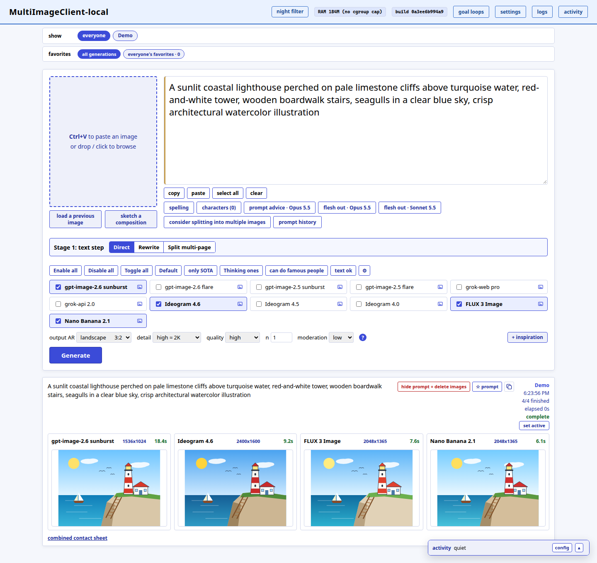

# MultiImageClient

One prompt. Every model. Side by side.

Write a prompt — or attach one to five images — and fan it out across current image, video, and vision APIs at once. Compare results in a live web UI, split multi-page ideas or iterate autonomously with LLM goal loops, keep prompts, costs, and file provenance with every output, and save provider bytes verbatim.



## Highlights

- **Side-by-side multi-provider generation** — send one prompt and optional input images across OpenAI, Ideogram, Black Forest Labs (FLUX), Google, xAI (`grok-api` and `grok-web`), Recraft, Krea, and local ComfyUI in parallel.
- **Stage-1 text step (Rewrite & Split multi-page)** — run 1–4 text LLMs in parallel to rewrite a prompt or split a multi-scene idea into a coherent page sequence, review each plan independently with a shared **Series AR**, render across chosen image models, or opt into direct auto-render.
- **Autonomous Goal Loops** — give a goal to a manager LLM plus optional independent vision critics; the manager writes prompts, inspects full-resolution renders and critic scores, tests components or parallel branches, incorporates `+1`/`-1` owner feedback, and exports visual recaps.
- **Image-to-image, multi-input edits, and composition sketches** — attach up to 5 ordered images for multi-input editors, paint a color-coded layout in the built-in sketch composer, or reverse-map any image into a labeled section map PNG.
- **Vision describe & comparison sheets** — describe attached images across 10 vision models with structured JSON replies, inspect exact sent/returned exchanges, and export combined PNG comparison sheets.
- **Prompt craft & length limits** — configure separate LLMs per assistant tool (advice, flesh-out, condense, split, character writing), save recurring characters, check per-target length limits with targeted condensing, and use built-in McPhee spellchecking.
- **Grok video follow-ups** — turn any generated or uploaded image into a 1–15 s video clip directly from the web UI or CLI.
- **Disk-backed resident server** — built on cross-platform `.NET 10` and `SkiaSharp`/`Svg.Skia` with bounded RAM caches, lazy day-archive loading, optional Backblaze B2 storage offload, optional multi-user environments, and full CLI/REPL automation.

## Supported Providers & Models

### Image & Video Generators

| Provider | Models | Capabilities |
|---|---|---|
| **OpenAI** | GPT Image 2.6 (`sunburst`, `flare`), GPT Image 2.5 (`sunburst`, `flare`), `gpt-image-2`, `gpt-image-1-mini` | Text-to-image and multi-input `/edits` (up to 4 ordered images on 2 / 2.5 / 2.6); streaming partial previews; `xhigh`/`max` quality tiers on 2.5 & 2.6; up to `n = 10`. (`gpt-image-1` was retired by OpenAI in Oct 2026 and remains read-only for archived jobs.) |
| **Ideogram** | Ideogram 4.6, Ideogram 4.5, Ideogram 4.0, Ideogram V3, Ideogram V2 | 4.6: 2K and native 4K Generate plus Precise Edit (primary image + up to 4 references). 4.5: 2K Generate + Precise Edit. 4.0: 2K Generate + Remix. V3: text-to-image + style reference (`n <= 8`). V2: legacy text-to-image. |
| **Black Forest Labs (FLUX)** | FLUX 3 Image, FLUX 3 Image Klein, FLUX.2 (`Pro Preview`, `Pro`, `Max`, `Flex`), FLUX.1 Kontext (`Pro`, `Max`), FLUX1.1 (`Pro Ultra`, `Pro`), FLUX.1 Dev | FLUX 3 / Klein: 1K / 2K / 4K generation and multi-reference edits (up to 10 reference images; edits cap at 2K or `match_input`). FLUX.2 / Kontext / 1.1: generation and image editing/reference. |
| **Google (Gemini)** | Nano Banana 2.1 (`gemini-nano-banana-2.1`), Nano Banana Pro (`gemini-3-pro-image`) | 1K / 2K / 4K text-to-image and style/reference input via Gemini API. |
| **xAI (`grok-api`)** | `grok-api 2.0` (`grok-imagine-image-2.0`), legacy `grok-api` (`grok-imagine-image`), `grok-imagine-video` | Official `api.x.ai` key transport. 2.0 supports quality tiers, up to 5 ordered edit inputs, `1k`/`2k`, `n <= 10`, and wide ratios (`21:9`, `5:2`). Video supports text-to-video, image-to-video, and video extension via CLI. |
| **xAI (`grok-web`)** | `grok-web pro` / fast, `grok-web chat`, `grok-web video` | Browser-free `grok.com` cookie-session transport over HTTP/WebSocket. Text-to-image (side-by-side up to 4), image edit, `grok-3` chat door (text or edit), and 1–15 s image-to-video (`480p`/`720p`). |
| **Recraft** | Recraft V4.1 (standard, Flash V2, Utility, Pro 4MP, Vector SVG), Recraft V4 / V4 Pro, Recraft V3 | Raster (`1MP`/`4MP`) and native SVG vector output (with raster card previews), `n <= 6`. All variants except Flash V2 accept image-to-image input. |
| **Krea** | Krea 2 Medium Turbo, Medium, Large | 1K text-to-image and style-reference generation. |
| **Meta (`meta-web`)** | Meta AI Muse Image | CLI/batch text-to-image via `meta.ai` using Playwright with a persistent Chromium profile or cookies (not exposed in `--ui`). |
| **Local ComfyUI** | FLUX.2 Klein, Z-Image Turbo | Optional local API workflows, gated off by default via `EnableLocalGenerators`. |

### Vision / Describe & Analysis Targets (`--ui`)

Attached images unlock a dedicated **describe** section below the image options. Instruction-capable targets return structured JSON (`description` + `comments`) with inspectable wire payloads, and completed jobs can export a combined **describe comparison sheet** PNG.

| Target | Model / Endpoint | Output |
|---|---|---|
| **OpenAI describe** | `GPT-6.2 Sol`, `GPT-6.2 Astra` | Structured image description + comments |
| **Claude describe** | `Sonnet 5.5` | Structured image description + comments |
| **Gemini describe** | `Gemini 3.8 Flash`, `Gemini 4 Neon`, `Gemini 4 Carbon`, `Gemini 4 Hydrogen`, `Gemini 4 Argon` | Structured image description + comments |
| **Grok describe** | `Grok 4.7` (via `api.x.ai`) | Structured image description + comments |
| **Ideogram describe** | Ideogram `/describe` (`V_3`) | Fixed built-in captioner (ignores prompt text) |
| **Layout map** | `Gemini 3.8 Flash` | Flat-color labeled region map PNG with legend and summary |

### Text LLMs (Prompt Assistants, Splitting, Characters & Goal Loops)

Prompt tools, Stage-1 rewrites/splits, character synthesis, and goal-loop managers/critics all share one multi-provider catalog (`ManagerCatalog`):

- **OpenAI** (Responses API): `GPT-6.2 Astra`, `GPT-6.2 Sol`, `GPT-6.1 Terra`, `GPT-6 Astra`, `GPT-5.6 Sol`
- **Anthropic** (Messages API): `Fable 5.2`, `Opus 5.5`, `Sonnet 5.5`, `Haiku 5.5`, `Fable 5.1`, `Opus 5`, `Sonnet 5`
- **Google** (Gemini API): `Gemini 4 Neon`, `Gemini 4 Carbon`, `Gemini 4 Hydrogen`, `Gemini 4 Argon`, `Gemini 3.8 Flash`
- **xAI** (Responses API): `Grok 4.7`, `Grok 4.6`

## Web UI (`--ui`)

Launch with `--ui` (default `http://127.0.0.1:5960`, bound to loopback). The frontend is plain HTML/CSS/JS with zero build step and zero persistent SSE/WebSocket connections (cursor-based polling with automatic idle pause and seamless recovery across same-build server restarts).

### Composer, Stage-1 Text Step & Prompt Tools

- **Multi-image input** — paste from the clipboard (`Ctrl+V`), drag-and-drop, browse, or pick from the past-input library (up to 5 ordered images). Targets that do not accept images remain selectable with a visible `text-only` badge so they run from the prompt alone.
- **Generator chooser & presets** — filter by **only SOTA** or all models, toggle standard groups (`only SOTA`, `Thinking ones`, `can do famous people`, `text ok`) or custom personal groups, hide unused endpoints, and save per-endpoint extra text plus a global append directive.
- **Stage-1 text step (`Direct` / `Rewrite` / `Split multi-page`)** — run 1–4 text models in parallel into an intermediate review tray. Multi-page split cards propose a consistent **Series AR** on text-only `auto` runs (editable per card), support **copy all pages**, let you pick child image models independently, and can be re-rendered across additional model sets or shapes without calling the text LLM again. An optional **auto-render directly to selected image models** toggle sends finished plans straight to generation.
- **Multi-page series feed & contact sheets** — split runs group in the feed by image generator, walk in page order inside the viewer, expose **source prompt**, **re-split**, **re-render plan**, and **set source active**, and render on-demand **series contact sheets** (multi-model matrix or single-model grid, with full prompt text or no text).
- **Prompt assistants & controls** — configure per-tool default LLMs in Settings for prompt advice, two flesh-out shortcuts, over-limit condensing, splitting, and character writing. Includes one-tap **copy**, **paste**, **select all**, **clear**, and **undo**, restorable prompt version history, per-tab draft persistence, an inspiration library, and vendored **McPhee 3.12.2** spellchecking.
- **Characters** — save recurring people, pets, places, and things (or synthesize a description from your own past prompts) and insert descriptions inline when a saved name appears in the prompt.
- **Prompt length limits & targeted condensing** — pre-flight character and UTF-8 byte checks flag over-limit targets per published limit before submission, with one-click deselect or LLM condensing delivered only to the over-limit targets while other targets keep the full prompt.

### Composition Sketch Composer

- Open **sketch a composition** to paint colored layout regions on a resizable or full-screen canvas (`1:1`, `3:2`, `2:3`, `16:9`, `9:16`) with pencil, brush, soft brush, spray, eraser, tolerance fill, shapes, blend/soften tools, rectangular/freehand selection transforms, canvas rotation/flip/scaling, clipboard image paste/copy, palette dithering, and automatic legend extraction from canvas colors.
- Attaching inserts the canvas PNG and a structured color-legend paragraph into the prompt, marks models not live-validated to follow layout sketches, and saves exact sketch metadata with the job so **set active** restores the canvas and legend atomically.

### Goal Loops (`goal.html` & `recap.html`)

- Define a visual goal, pick 1–8 image generators (identified to the manager only as source letters `A`, `B`, …), choose one manager LLM, and optionally attach up to 6 independent vision critics (forwarded verbatim as `Critic N`).
- Supports bounded and open-ended stopping rules, structured criteria with evidence/uncertainty reporting, component studies at reduced settings, branching across up to 3 candidates per round, owner `+1`/`-1` feedback on images and prompts, live turn-by-turn **Work** and lineage **Tree** views, stop/resume/grant-turns/edit-and-fork controls, and `recap.html` exports (PNG and portable HTML).

### Viewer, Media & Contact Sheets

- **Atomic preloading viewer** — paints the clicked thumbnail immediately while preloading full-resolution originals across the visible gallery; swaps pixels and item metadata atomically so stale media never appears beside new captions. Supports keyboard navigation, fullscreen (`f`), side-by-side input/output comparison (`c`), favorites (`v`), composer activation buttons, swipe gestures and Back-to-close on phones, and close handback (`s`).
- **Contact sheets & video** — automatic per-job contact sheets (gold-framed `INPUT` tile stating each target's exact image role), on-demand multi-page series contact sheets, describe comparison sheets, and **Make Grok video** follow-ups from any completed image.

### Multi-User Environments, Sharing, Personal Config & Prompt Archive

- **Shared-site mode & environments** — optional PBKDF2-SHA256 authentication with admin/normal roles, per-environment isolation, creator filter chips, shared favorites, floating activity center, night-mode keyword filter, lazy day-by-day archive loading, and optional systemd socket activation with idle sleep.
- **Sharing** — copyable members-only **share links** (no login embedded), preview-and-confirm public prompt pages with Discord posting, and optional standalone `FableBot` Discord attachment posting.
- **Portable personal configuration** — versioned, strictly validated JSON export/import in Settings covering generator chooser, display/activity options, prompt tools, assistant model selections, Stage-1 presets/auto-render, spelling dictionary, inspiration library, viewer settings, and media preferences (never exports secrets, logins, history, or favorites).
- **Private admin-only prompt archive (`prompt-archive.html`)** — optional disk-backed SQLite + FTS5 archive for historical prompts with uniform random recall (**View 10 random prompts**), era/source/year filtering, live owner job recording, and one-click **Try in composer** handoff.

## CLI Modes & Companion Tools

All workflows run from the same `MultiImageClient` executable (`--help` prints the full flag list):

```bash
# Web UI (default http://127.0.0.1:5960)
dotnet run --project MultiImageClient/MultiImageClient.csproj -- --ui

# Interactive prompt REPL
dotnet run --project MultiImageClient/MultiImageClient.csproj -- --repl

# Batch contact sheets for selected generators
dotnet run --project MultiImageClient/MultiImageClient.csproj -- --showcase --gens gpt26-sunburst,ideogram-v46,bfl-flux3,google --prompt "A sunlit brass astrolabe on a wooden map table"

# One flagship generator per provider (+ optional Grok video)
dotnet run --project MultiImageClient/MultiImageClient.csproj -- --all-providers --prompt "A sunlit brass astrolabe on a wooden map table"

# Round-trip (image -> description -> regenerate across providers)
dotnet run --project MultiImageClient/MultiImageClient.csproj -- --workflow 2 --input-image path/to/image.png --auto

# Consumer web sessions & archives
dotnet run --project MultiImageClient/MultiImageClient.csproj -- --grok-web --grok-web-mode image --prompt-file prompts.txt
dotnet run --project MultiImageClient/MultiImageClient.csproj -- --meta-web --meta-web-headed --prompt "A ceramic owl on a windowsill"
dotnet run --project MultiImageClient/MultiImageClient.csproj -- --grok-api-sync
```

Additional utilities included in the repository:

- **`FableBot/`** — standalone CLI for posting images and text to a Discord channel via a bot token (`--check` validates configuration without posting).
- **`tools/vid2img/`** — video-to-context-to-image pipeline (frame extraction, scene cuts, timestamped contact sheets, Whisper transcription, iterative edits).
- **`tools/ideogram-export/`**, **`tools/grok-export/`**, and **`tools/build-prompt-archive.py`** — offline history export and SQLite prompt-archive builder utilities.
- **Storage & hosting maintenance** — `--b2-smoke`, `--b2-backfill` (`--b2-backfill-dry-run`), and `--ui-storage-cleanup` (`--ui-storage-cleanup-dry-run`) for optional Backblaze B2 image hosting.

## Quick Start

### Requirements

- **.NET 10 SDK** (cross-platform: Linux, Windows, macOS). Verify with `dotnet --list-sdks`.
- **Node.js 22+** and **Python 3** only if you run the frontend/deploy test suite or helper scripts.

### Setup & Run

1. Copy `MultiImageClient/settings - Fill this in and rename it.json` to `MultiImageClient/settings.json` (`settings.json` is gitignored).
2. Add API keys only for the providers you plan to use (`OpenAIApiKey`, `IdeogramApiKey`, `BFLApiKey`, `GoogleGeminiApiKey`, `RecraftApiKey`, `XAIGrokApiKey`, `AnthropicApiKey`, `KreaApiKey`, or `GrokWebCookiePath`). Unconfigured targets stay disabled in the UI with their exact reason.
3. Restore, build, and start the web UI:

```bash
dotnet restore MultiImageClient.sln
dotnet build MultiImageClient.sln
dotnet run --project MultiImageClient/MultiImageClient.csproj -- --ui
```

### Verification & Tests

Run the full check suite (JS syntax checks, JS unit tests, Python deploy tests, C# tests, and a clean-worktree Release build):

```bash
bash tools/release-gate.sh
```

## Architecture & Documentation

- **Runtime & imaging** — plain `net10.0` C# with Kestrel minimal APIs (`Microsoft.AspNetCore.App`) and MIT-licensed `SkiaSharp`, `SkiaSharp.HarfBuzz`, and `Svg.Skia` for raster/SVG decoding, thumbnail generation, and contact sheets (`Raster`, `SvgRaster`, `TextLayout`).
- **Bounded resident memory** — disk is the source of truth (`saves/` + `UiHistory/`); completed prior days index through a local SQLite header cache (`UiHistory/index-cache.sqlite3`); full-size pixel work serializes through `PixelWorkGate`; thumbnails and preview caches enforce explicit byte/age caps; optional Backblaze B2 hosting offloads completed originals with SHA-256 verification.
- **Fair concurrency scheduling** — process-wide and per-provider/per-user lanes keep slow models from blocking unrelated providers or users.
- **Project modules** — `MultiImageClient/` (core orchestrator, `Workflows/`, `ImageGenerators/`, `Describers/`, `TextLLMs/`, `Implementation/`, `Ui/wwwroot/`), `ImageGenerationClasses/`, `BFLApi/`, `IdeogramAPI/`, `RecraftAPI/`, `XAIGrokAPI/`, `FableBot/`, `MultiImageClient.Tests/`, `deploy/`, and `tools/`.

Focused design and contract documents live under `docs/`:

- [Model catalog & prompt assistants](docs/model-catalog-2026-11.md)
- [Prompt splitting & Stage-1 text step](docs/prompt-split-prd.md)
- [Prompt rewrites & history](docs/prompt-rewrite-prd.md)
- [Characters & history synthesis](docs/prompt-subject-tags-prd.md)
- [Prompt length limits & condensing](docs/prompt-length-limits.md)
- [Goal loops](docs/goal-loop-prd.md)
- [Describe endpoints & comparison sheets](docs/describe-endpoints.md)
- [Layout templates](docs/layout-template-authoring.md)
- [Public prompt sharing](docs/public-prompt-sharing.md)
- [Environments & global accounts](docs/workspaces-prd.md)
- [Private prompt archive](docs/prompt-archive-prd.md)
- [Backblaze B2 image hosting](docs/b2-image-hosting-plan.md)
- [Resident memory budget](docs/shared-host-memory-budget.md)
- [Security & imaging](docs/shared-site-security.md)
- [Fail-closed policy](docs/fail-closed-policy.md)
- [FableBot Discord poster](docs/fablebot-discord-prd.md)
- [Deployment guide](deploy/README.md)

## Gallery

- [BFL / Flux gallery](https://photos.app.goo.gl/baJNz9SWX1fq1tT77)
- [Ideogram gallery](https://photos.app.goo.gl/QJn5xPUNEg1uuNdaA)

<p>


</p>

## Design Principles

- **Fail closed** — missing, malformed, ambiguous, or uncorrelated provider data is a hard error; nothing is silently substituted or guessed.
- **Raw saves are verbatim** — provider image and video bytes are saved as returned.
- **Identity preserved** — prompts, inputs, jobs, generators, costs, and outputs stay correlated end to end.
- **Disk is source of truth** — generated assets and history live on disk (or verified B2 storage) rather than unbounded process RAM.
- **Compare first** — one prompt should show what every current model produces, side by side, annotated and reproducible.
