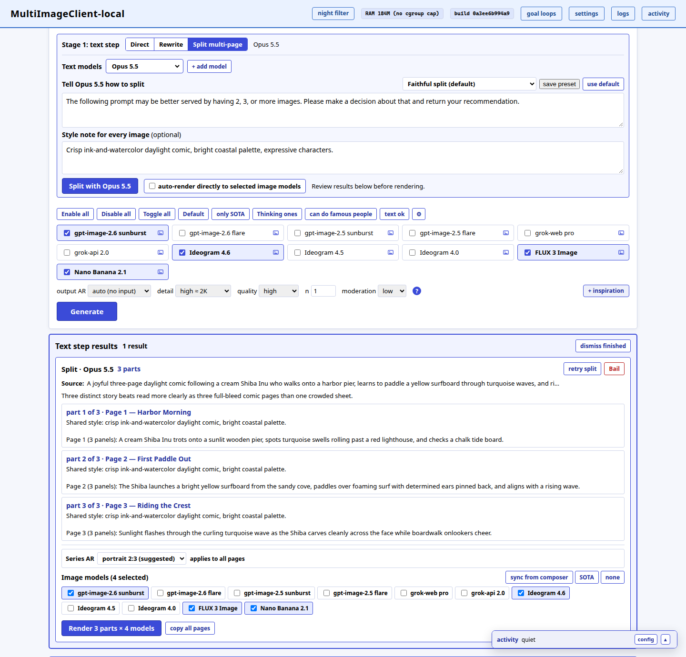
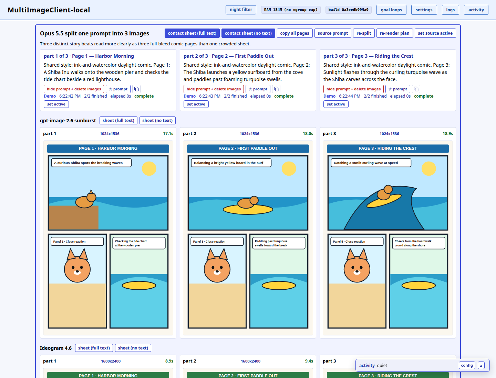
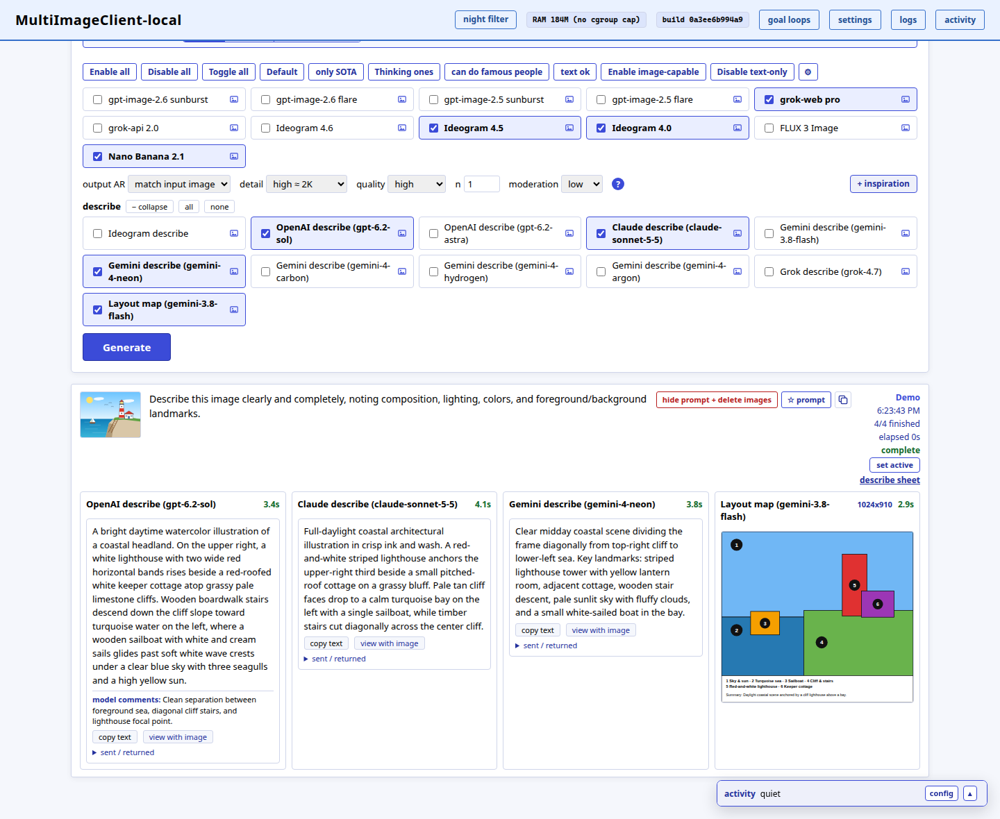
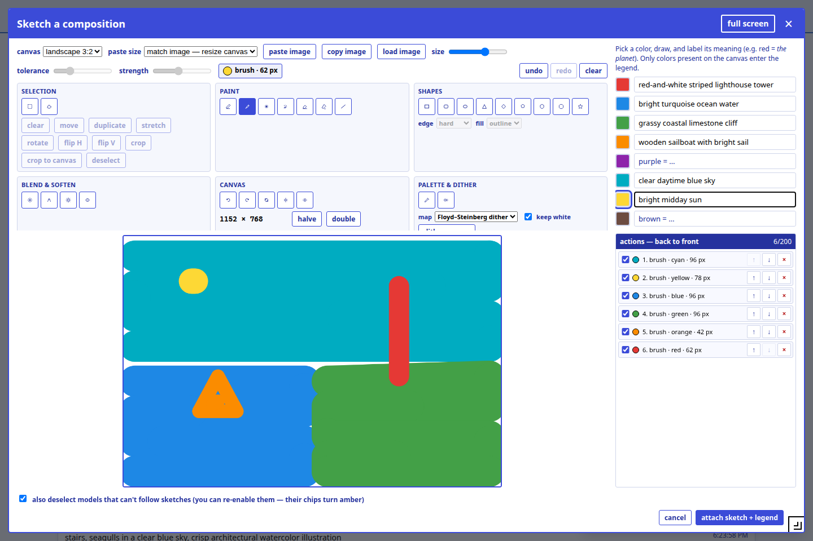
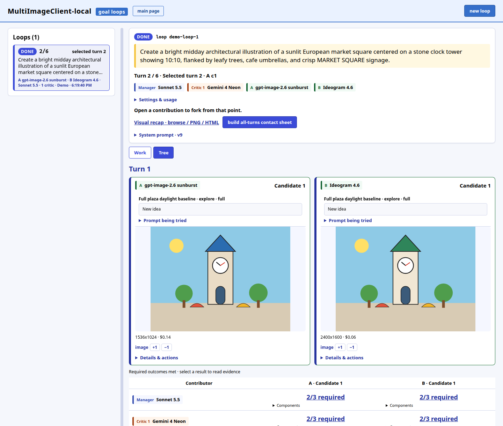

# MultiImageClient

One prompt, multiple image models side by side — with multi-page story splitting, prompt rewrites, image description and layout mapping, composition sketching, video follow-ups, and autonomous goal loops in one web app.


## What You Can Do

- **Compare models side by side** — send one prompt (with or without up to 5 reference images) to any mix of image generators at once, view timing, dimensions, and estimated cost per image, and get an automatic combined contact sheet.
- **Turn one idea into a multi-page series** — use **Stage 1: Split multi-page** to break a story or complex concept into 2–8 coordinated pages across 1–4 text LLMs, pick a shared **Series AR**, review and render across chosen image models, and export full-series contact sheets.
- **Rewrite, flesh out, and condense prompts** — run parallel Stage-1 rewrites, get prompt advice, expand ideas with two one-click flesh-out buttons, save recurring **Characters**, check per-model prompt limits with targeted condensing, and spellcheck as you type.
- **Describe and map any image** — attach an image to run up to 10 vision describers plus **Layout map**, inspect the exact prompt and raw reply, and export a single **describe sheet** PNG.
- **Sketch a layout first** — draw color-coded regions in the built-in **Sketch a composition** editor and attach the sketch plus legend straight into your prompt.
- **Iterate automatically with Goal Loops** — hand a visual goal to a manager LLM and optional independent critics that design prompts, score renders against explicit criteria, branch ideas, and export visual recaps.
- **Animate any result** — click **grok video** on any completed image to turn it into a 1–15 s clip.

---

## Multi-Target Generation

Pick any combination of image models before hitting **Generate**, or switch quickly with preset buttons:

- **View filter**: start in **only SOTA** (11 flagship models) or switch to **all models** in Settings; hide individual endpoints you never use.
- **Group selection buttons**: **only SOTA**, **Thinking ones**, **can do famous people**, **text ok**, **Default**, **Enable all / Disable all / Toggle all**, plus your own custom personal groups. While an image is attached, **Enable image-capable** and **Disable text-only** also appear.
- **Unified output options**: set **output AR** (`auto` / `match input image`, `square 1:1`, `landscape 3:2`, `portrait 2:3`, `wide 16:9`, `tall 9:16`), **detail** (`standard ≈ 1K`, `high ≈ 2K`, `max ≈ 4K`), **quality** (up to `xhigh` / `max` on supported models), **n** (image count), and **moderation**. Each provider maps the options it supports.
- **Multi-image inputs**: paste (`Ctrl+V`), drag-and-drop, browse, or reuse past uploads (up to 5 ordered images). Targets that do not accept images stay selectable with a clear `text-only` indicator and run from the prompt alone.
- **Per-endpoint extra text & global directive**: configure persistent suffix text per endpoint plus a global append line in Generator configuration (`⚙`), along with an on/off bright-daylight guidance toggle for OpenAI image models.
- **Live progress & contact sheets**: OpenAI image models stream partial previews as they render. Completed jobs generate a combined contact sheet (with a gold-framed `INPUT` tile stating each model's exact image role when inputs were attached).

### Supported Image & Video Targets

| Provider | Targets | Input & Output Notes |
|---|---|---|
| **OpenAI** | `gpt-image-2.6 sunburst`, `gpt-image-2.6 flare`, `gpt-image-2.5 sunburst`, `gpt-image-2.5 flare`, `gpt-image-2`, `gpt-image-1-mini` | Text-to-image and multi-input edits (up to 4 ordered images on 2 / 2.5 / 2.6), sketch-capable, streaming partial previews, `xhigh`/`max` quality tiers on 2.5 & 2.6, `n <= 10`, 32,000-char prompt limit. `gpt-image-1-mini` is text-only. *(Retired `gpt-image-1` remains display-only for archived jobs.)* |
| **Ideogram** | `Ideogram 4.6`, `Ideogram 4.5`, `Ideogram 4.0`, `Ideogram V3`, `Ideogram V2` | **4.6**: 2K and native 4K Generate + Precise Edit (primary image + up to 4 references), 10,000-char limit. **4.5**: 2K Generate + Precise Edit, 10,000-char limit. **4.0**: 2K Generate + Remix. **V3**: text-to-image + style reference (`n <= 8`). **V2**: legacy text-only. |
| **Black Forest Labs (FLUX)** | `FLUX 3 Image`, `FLUX 3 Image Klein`, `FLUX.2 Pro Preview`, `FLUX.2 Pro (pinned)`, `FLUX.2 Max`, `FLUX.2 Flex`, `FLUX.1 Kontext Pro`, `FLUX.1 Kontext Max`, `FLUX1.1 Pro Ultra`, `FLUX1.1 Pro`, `FLUX.1 Dev` | **FLUX 3 Image / Klein**: 1K / 2K / 4K generation and multi-reference edits (up to 10 references; edits up to 2K or match input). **FLUX 3 Image** and **FLUX.2** family are sketch-capable. **Kontext** and **1.1** support image-guided generation and editing. *(Operator-disabled legacy entries `FLUX.2 Klein 4B/9B` and `FLUX.1 Pro` compatibility stay visible in archive history only.)* |
| **Google** | `Nano Banana 2.1`, `Nano Banana Pro` | `gemini-nano-banana-2.1` (sketch-capable) and `gemini-3-pro-image` at 1K / 2K / 4K, text-to-image and image reference. |
| **xAI (`grok-api`)** | `grok-api 2.0`, `grok-api`, `grok-imagine-video` (CLI) | Official `api.x.ai` key transport. **2.0** (`grok-imagine-image-2.0`): quality tiers, up to 5 ordered edit inputs, sketch-capable, `1k`/`2k`, `n <= 10`, wide ratios (`21:9`, `5:2`). Legacy **grok-api** (`grok-imagine-image`): 16,000-char limit. Video supports text-to-video, image-to-video, and video extension in CLI. |
| **xAI (`grok-web`)** | `grok-web pro` (and fast tier), `grok-web chat`, `grok-web video` | Consumer `grok.com` session transport (no browser required). **grok-web pro**: up to 4 side-by-side renders (8,192 UTF-8 byte text limit) and full-prompt image edits, sketch-capable. **grok-web chat**: text or image edit via `grok-3`, sketch-capable. **grok-web video**: 1–15 s image-to-video (`480p`/`720p`, Normal / Funny / Custom / Spicy). |
| **Recraft** | `Recraft V4.1`, `Recraft V4.1 Flash V2`, `Recraft V4.1 Utility`, `Recraft V4.1 Pro`, `Recraft V4.1 Vector`, `Recraft V4`, `Recraft V4 Pro`, `Recraft V3` | Raster (`1MP` / `4MP` on Pro) and native SVG vector output with raster card previews (`Recraft V4.1 Vector`), `n <= 6`. Image-to-image on all variants except text-only `Flash V2`. 10,000-char limit on V4/V4.1, 1,000-char limit on V3. |
| **Krea** | `Krea 2 Medium Turbo`, `Krea 2 Medium`, `Krea 2 Large` | 1K text-to-image and style-reference generation. |
| **Meta (`meta-web`)** | Meta AI Muse Image (CLI/batch) | Text-to-image through `meta.ai` via Playwright session (CLI/showcase; not exposed in `--ui`). |
| **Local ComfyUI** | `local FLUX.2 Klein`, `local Z-Image Turbo` | Optional local ComfyUI API targets, off by default unless enabled in settings. |

---

## Multi-Page Images

Turn a story, comic, sequence, or dense multi-scene idea into a coordinated series of 2–8 images using the inline **Stage 1: text step** bar directly above the model chooser.



### How Multi-Page Splitting Works

- **Parallel text writers**: pick **1 to 4 text LLMs** to split the same prompt in parallel and compare their page breakdowns side by side.
- **Built-in & custom split presets**: start with **Faithful split (default)** or **8-page visual story (show, don't tell)**, edit the split instruction freely, save your own reusable presets, and add an optional **Style note for every image** to keep visual style consistent across pages.
- **Review before generating**: by default, each writer opens an independent review card in **Text step results** showing the rationale and every page's title and prompt — nothing spends image credits until you approve it.
- **Consistent Series AR**: for text-only `auto` splits, the splitter suggests one shared aspect ratio for the whole sequence (`portrait 2:3`, `landscape 3:2`, `square 1:1`, `wide 16:9`, `tall 9:16`, or `auto` for unrelated subjects). You can change **Series AR** per card before rendering; an explicit composer `output AR` always takes precedence, and attached-image `auto` splits stay on `match input image`.
- **Reusable plans & one-click copy**: pick any set of child image models on the card, click **Render P parts × M models** (and re-render the same plan on different image models or aspect ratios without calling the text LLM again), **copy all pages** as one formatted text block, **retry split**, or **Bail**. If a model recommends keeping the idea as one image, the card offers **Render unsplit**.
- **Optional direct auto-render**: check **auto-render directly to selected image models** (saved in your personal configuration) to send finished split or rewrite plans straight into image generation without stopping at the review click.



### Multi-Page Series Feed & Contact Sheets

- **Grouped by generator**: rendered pages appear together inside one series block, arranged cleanly per image model so you can read a full sequence left-to-right and compare models top-to-bottom.
- **Series actions**: every split group header includes **contact sheet (full text)** and **contact sheet (no text)** (both full multi-model sheets and per-model sheets), **copy all pages**, **source prompt**, **re-split**, **re-render plan**, **set source active**, and multi-page series sharing.
- **Sequential viewer walk**: clicking any page opens the full-screen viewer and steps through that generator's pages in order.

---

## Prompt Rewrites & Text Assistant Systems

MultiImageClient includes six LLM-powered text workflows plus direct prompt-editing tools — all configurable per tool in **Settings → Prompt assistant models**.

### Rewrite & Assistant Systems

| System | Where It Lives | What It Does |
|---|---|---|
| **Stage-1 Rewrite** | **Stage 1: text step → Rewrite** | Runs 1–4 text LLMs in parallel into editable review cards. Includes built-in presets (**Standard flesh-out (default)** and **Multi-panel story page (show, don't tell)**) plus your own saved presets. From any card you can edit the text, pick child image models and render, click **Use in prompt**, **Bail**, or check **auto-render directly to selected image models**. |
| **Prompt advice** | **prompt advice** button under `#prompt` | Reviews your current prompt, gives concrete suggestions, and offers a one-click replacement (default: `Opus 5.5`). |
| **Flesh out (primary & secondary)** | Two **flesh out** buttons under `#prompt` | One-click prompt expansion wired to two independent configurable models (defaults: `Opus 5.5` and `Sonnet 5.5`) so you can keep a flagship and a fast option side by side. |
| **Split multi-page** | **Stage 1: text step → Split multi-page** (or **consider splitting into multiple images**) | Breaks one prompt into 2–8 coordinated image prompts with shared style and suggested **Series AR** (default: `Opus 5.5`). |
| **Over-limit condensing** | Automatic **condense** button on red prompt-limit warnings | Pre-flight checks flag targets whose published character limit your prompt exceeds (e.g., 1,000 on Recraft V3, 10,000 on Ideogram 4.5/4.6 & Recraft V4.x, 16,000 on grok-api, 32,000 on GPT image models). Condensing writes a shorter version delivered *only* to those over-limit targets while every other target keeps your full prompt (default: `Sonnet 5.5`). |
| **Characters (recurring subjects)** | **characters** drawer under `#prompt` | Stores named descriptions for recurring people, pets, places, and things. Whenever a saved name appears in the prompt, a one-click **describe** strip inserts its description inline. Includes **write it from my prompts** to synthesize a character description from your past prompts (default: `Opus 5.5`). |

Under the prompt box you also get:

- **Direct field buttons**: one-tap **copy**, **paste**, **select all**, **clear**, and contextual **undo clear** / **undo paste** (sized for touchscreens as well as desktop).
- **Prompt history & undo**: browse past AI rewrites and advice, restore earlier versions, or **undo edit** in one click.
- **Spelling**: built-in **McPhee 3.12.2** spellchecker with customizable levels (including capitalization checks) and a personal dictionary.
- **Inspiration library & drafts**: store reusable prompt directions under **+ inspiration**; composer and goal-loop text auto-save per tab across reloads.

### Supported Text LLMs (19 Models)

Every prompt assistant, Stage-1 rewrite/split writer, character writer, and goal-loop manager/critic draws from the same 19-model catalog:

| Provider | Models |
|---|---|
| **OpenAI** | `GPT-6.2 Astra`, `GPT-6.2 Sol`, `GPT-6.1 Terra`, `GPT-6 Astra`, `GPT-5.6 Sol` |
| **Anthropic** | `Fable 5.2`, `Opus 5.5`, `Sonnet 5.5`, `Haiku 5.5`, `Fable 5.1`, `Opus 5`, `Sonnet 5` |
| **Google** | `Gemini 4 Neon`, `Gemini 4 Carbon`, `Gemini 4 Hydrogen`, `Gemini 4 Argon`, `Gemini 3.8 Flash` |
| **xAI** | `Grok 4.7`, `Grok 4.6` |

---

## Describe Tools & Layout Map

Attaching one or more images automatically reveals the **describe** section beneath the image options. Run any combination of vision models alongside or instead of image generators — leave the prompt blank to use the built-in detailed description instruction, or type custom questions and focus instructions.



### Describe & Analysis Options (11 Targets)

| Target | Underlying Model / Endpoint | Output |
|---|---|---|
| **OpenAI describe (gpt-6.2-sol)** | `gpt-6.2-sol` | Structured description + separated model comments |
| **OpenAI describe (gpt-6.2-astra)** | `gpt-6.2-astra` | Structured description + separated model comments |
| **Claude describe (claude-sonnet-5-5)** | `claude-sonnet-5-5` | Structured description + separated model comments |
| **Gemini describe (gemini-3.8-flash)** | `gemini-3.8-flash` | Structured description + separated model comments |
| **Gemini describe (gemini-4-neon)** | `gemini-4-neon` | Structured description + separated model comments |
| **Gemini describe (gemini-4-carbon)** | `gemini-4-carbon` | Structured description + separated model comments |
| **Gemini describe (gemini-4-hydrogen)** | `gemini-4-hydrogen` | Structured description + separated model comments |
| **Gemini describe (gemini-4-argon)** | `gemini-4-argon` | Structured description + separated model comments |
| **Grok describe (grok-4.7)** | `grok-4.7` (via `api.x.ai`) | Structured description + separated model comments |
| **Ideogram describe** | Ideogram `/describe` (`V_3`) | Fixed built-in captioner (ignores prompt text) |
| **Layout map (gemini-3.8-flash)** | `gemini-3.8-flash` | Flat-color labeled region map PNG with numbered legend and one-sentence summary |

Every describe result includes **copy text**, **view with image** (opens the submitted image alongside the full description in the viewer), and an expandable **sent / returned** inspector showing the exact wire prompt and raw provider reply. Completed jobs also offer **describe sheet**, which exports all inputs, full descriptions, comments, and layout maps into one combined PNG.

---

## Composition Sketch Composer

Click **sketch a composition** under the image paste zone to lay out where subjects belong before generating.



- **Color-coded layout + legend**: pick from the 8-color legend (or extract 1–8 colors directly from a pasted/loaded image), paint regions, and label what each color represents. Only colors actually drawn on the canvas enter the prompt legend.
- **Full canvas editor**: resizable or full-screen dialog across `1:1`, `3:2`, `2:3`, `16:9`, and `9:16` canvases; pencil, brush, soft brush, spray, eraser, tolerance bucket fill, straight lines, hard/soft outlined or filled shapes, rectangular and lasso selection transforms (move, duplicate, stretch, rotate, flip, crop), blend/soften brushes, canvas rotation/flip/halve/double, clipboard paste/copy, Floyd-Steinberg palette dithering, and reorderable action stack.
- **Sketch-aware model guidance**: attaching inserts the sketch PNG and a structured legend paragraph telling models to follow the placement while repainting completely in your chosen style. Models that cannot follow layout sketches are highlighted in amber (with an option to deselect them automatically on attach). Clicking **set active** on a past sketch job restores the exact canvas and legend.

---

## Autonomous Goal Loops

Open **goal loops** (`goal.html`) to let an LLM iteratively refine prompts until your visual goal is met.



- **Blind multi-generator testing**: select 1–8 image generators (shown to the manager only as source letters `A`, `B`, …), one **Manager** LLM, and **0–6 independent Critics** (clean vision calls forwarded verbatim as `Critic 1`, `Critic 2`, …).
- **Criteria, experiments & branching**: define required and preferred outcomes; the manager can test full scenes or component studies, branch up to 3 candidates per turn from exact parent images, and apply bounded or open-ended stopping rules.
- **Human in the loop**: rate any rendered image or prompt `+1` / `-1` to steer later turns; pause, resume, grant more turns, or **edit & fork** from any entry.
- **Work, Tree & Recaps**: toggle between chronological **Work** and lineage **Tree** views, build all-turns contact sheets, and open **Visual recap** (`recap.html`) with best/latest/all/per-generator filters and PNG or portable HTML exports.

---

## Viewer, Video Follow-Ups & Everyday Controls

- **Instant preloading viewer**: opens immediately on the clicked card thumbnail while preloading full-resolution originals across the visible feed. Supports arrow keys / swipe navigation, fullscreen (`f`), side-by-side input/output comparison (`c`), favorites (`v`), composer handoff buttons, and Back-to-close on mobile.
- **Make Grok video**: hover any completed image tile (from any provider) and click **grok video** to animate it into a 1–15 s MP4 (`480p` or `720p`, `Normal` / `Funny` / `Custom` / `Spicy` modes), with inline playback and one-click **redo grok video**.
- **Portable personal configuration**: export or import one JSON file under **Settings** carrying your model visibility, custom groups, per-endpoint extra text, prompt assistant models, Stage-1 presets and auto-render preference, spelling dictionary, inspiration library, and viewer preferences (never includes API keys, credentials, or history).
- **Multi-user workspaces & sharing**: optional login and role-based workspaces with creator filters, shared favorites, floating activity dock, optional night-mode keyword filter, day-by-day archive loading, copyable members-only **share links**, preview-and-confirm public prompt sharing (including multi-page series), and optional admin-only lifetime **Prompt Archive** (`prompt-archive.html`) with full-text search, **View 10 random prompts**, and one-click **Try in composer**.
- **Phone-ready layout**: responsive portrait and landscape phone layout with a single-row header, full-width prompt entry, sticky Generate bar, collapsible long job prompts, and swipeable full-screen viewer.

---

## Gallery

- [BFL / Flux gallery](https://photos.app.goo.gl/baJNz9SWX1fq1tT77)
- [Ideogram gallery](https://photos.app.goo.gl/QJn5xPUNEg1uuNdaA)

<p>


</p>

---

## Setup & Technical Notes

- **Requires**: [.NET 10 SDK](https://dotnet.microsoft.com/download/dotnet/10.0) (Linux, Windows, or macOS). Built with plain C# (`net10.0`), Kestrel minimal APIs, no-build HTML/CSS/JS frontend, and `SkiaSharp` / `Svg.Skia`. Raw provider bytes are saved verbatim on disk (`saves/` + `UiHistory/`), with optional Backblaze B2 storage offload.
- **Configure**: copy `MultiImageClient/settings - Fill this in and rename it.json` to `MultiImageClient/settings.json` (gitignored) and paste API keys only for the providers you want to use.
- **Run the web UI** (default `http://127.0.0.1:5960`):

```bash
dotnet run --project MultiImageClient/MultiImageClient.csproj -- --ui
```

- **CLI & tests**: run `--help` for batch/CLI modes (`--repl`, `--showcase --gens ...`, `--all-providers`, `--workflow 2`, `--grok-web`, `--meta-web`), `bash tools/release-gate.sh` for the full check suite, and see [`docs/`](docs/) for feature specifications and deployment notes.
